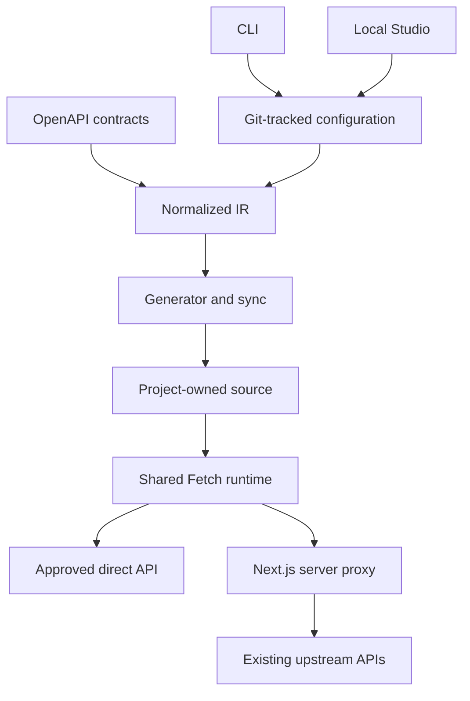

# Architecture baseline

Status: conceptual architecture, not an implementation specification. Package names and boundaries below are proposed until module contracts are reviewed.

## Two planes, one project

Development plane: CLI and local Studio read/write modular JSON configuration, import API contracts, produce a normalized IR, generate and diff project-owned source. Git is the source of truth; there is no required Studio database.

Runtime plane: generated code consumes shared HTTP/runtime packages. Direct requests use permitted upstream APIs and upstream authorization. Proxy requests enter a Next.js server-side route handler and execute a configured endpoint against approved upstream resources. Future composite operations use the same endpoint model; no runtime code generation. The existing deployment/network remains responsible for reaching upstreams.

## Proposed package map

| Package | Responsibility |
|---|---|
| core | Shared configuration contracts, diagnostics, schema/version handling |
| openapi | Import, validation, reference resolution, normalized IR |
| codegen | Deterministic emitters, selection, output ownership and sync |
| http | Fetch transport, error contracts, request/response handling |
| query | Query key/options conventions and runtime helpers |
| next | Next.js server/client entrypoints and proxy adapter |
| cli | Developer commands, filesystem orchestration and scaffolding |
| studio | Local developer UI and controlled file/API access |
| auth, permissions, bff | Future server runtime modules, policy and orchestration |
| forms, tables, mock, observability, collections | Later independent packages; boundaries pending |

Monorepo, separately installable packages, unified release version. Turborepo/pnpm/Changesets are proposed tooling consistent with prior planning. Dependencies flow toward stable public contracts; no cycles. Studio/CLI depend on development services, not the reverse. Browser entrypoints cannot import server-only credentials/runtime.

## Data and configuration

One root config plus resource, endpoint and reusable module files; JSON Schema and explicit schema version/migration. Environment variables or existing secret managers hold values; config contains references only. Environment override precedence and hard policy enforcement require specification. Generated output is domain-organized, e.g. src/generated/policy/{types,service,queries,mutations,schemas,index}.ts; exact names are design work. Handwritten extensions live outside generated ownership.

The IR is the common contract for upstream OpenAPI, configured proxy operations and future managed collections. Runtime types must reflect normalized exposed contracts, not blindly mirror upstream shapes. Define semantics for errors, pagination, empty/binary responses, nullability, composition, validation and security metadata before coding.

## Security and quality

Server-side proxy: allowlisted resources, no arbitrary URL forwarding, strict trust boundaries, redacted diagnostics, bounded execution and safe auth forwarding. Direct mode only where backend enforces access. A preset by itself cannot enforce enterprise policies: CI and runtime controls must be designed. Untrusted spec/config input requires SSRF/path traversal/code injection protections. Tests use synthetic contracts. Real company examples require authorization and must stay outside this public repository.

See [open decisions](../decisions/OPEN-DECISIONS.md) for unresolved contracts and threat model tasks.
