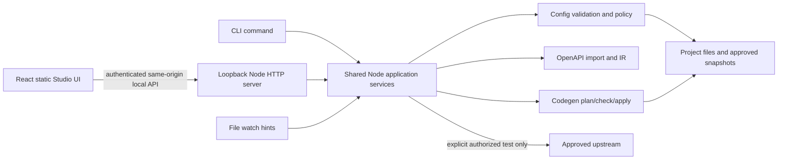

# CLI and local Studio v1

Status: accepted design baseline under ADR-020; implementation and verification pending. S0-07 (#7), D-02. ADR-015/016/017/018 apply. S0-06 detailed security design (ADR-019) is accepted; network playground implementation depends on approved controls. No implementation or dependency installation.

## Stack and package boundaries

Propose Commander for CLI (typed command parsing/help, no bespoke parser), Node HTTP server with small explicit route dispatcher and bounded JSON decoding, React + Vite static SPA served from packaged assets by the same local server, Base UI primitives, Tailwind CSS, React Hook Form, Zod for UI/form helpers, TanStack Query for local API reads, Chokidar for file watching. Configuration schemas and authoritative validation come from core, not duplicated Zod UI rules. Exact dependency versions and license/build/OS smoke tests required in implementation. React/Vite build dependencies belong to Studio; application need not run Vite or another Next server. No CDN fonts/scripts, analytics, external assets or Studio database. Browser bundle is separate from Node server exports; CLI lazily loads Studio only when requested. Package @frontspan/cli and binary frontspan are proposals pending npm namespace verification. Studio may be separately installed, loaded through known package export and matching unified version; no automatic download or execution. CLI and Studio share Node application service layer: open project, load/validate, edit plan, import, select, preview, apply, check, recover, test. Place service orchestration in CLI development-side module initially or separate internal workspace package if dependency cycle would arise; Studio server receives service interface, never imports CLI entrypoint. core/openapi/codegen do not depend on CLI or Studio; runtime never depends on development plane.

Alternatives: native parseArgs saves dependency but command help/nesting and validation require more code; Commander preferred. Next.js Studio requires a separate framework server despite no SSR need; static SPA simpler. Electron introduces desktop packaging and OS updates; hosted UI introduces remote trust and data movement. Node HTTP minimizes framework overhead but security middleware is explicit and must be tested; a small vetted framework is fallback if route/bounds complexity grows. Polling as simple baseline, chokidar events as invalidation hints, not authoritative state. No public plugin framework.

## CLI command contract

Use project-local pinned CLI after bootstrap, e.g. pnpm exec frontspan or npm exec -- frontspan. npx @frontspan/cli@<approved-version> only for explicit bootstrap. Unversioned examples are illustrative, not released package names.

| Command | Behavior |
|---|---|
| init | Existing Next App Router project inspection, preview install plan and create config with explicit apply |
| create <name> | New project from shipped versioned template, target must be absent/empty, preview then apply |
| add <module> | Explicit known module dependency closure, preview existing app modifications |
| doctor | Read-only Node/Next/package-manager/module/config checks; no remote calls |
| validate | Offline configuration and references against approved inputs, no writes |
| import <resource-id> | Load configured source explicitly, validate and preview catalog; no implicit network except explicitly configured/imported URL policy |
| select <resource-id> | Preview materializing explicit endpoint files from candidate operations; explicit apply |
| generate --preview / generate | Offline generation from pinned baseline; apply only when authorized under ADR-018 |
| sync --preview | Explicit load candidate and show semantic changes/impact/artifact plan; no writes |
| sync --apply-compatible | Explicit opted-in compatible apply only |
| sync --apply --approve <digest> | Exact prior reviewed plan only; stale/conflict/invalid blocked |
| check | Offline lock/snapshot/artifact verification, no writes |
| sync --check-remote | Explicit approved remote drift check; report only |
| migrate --preview / migrate --apply | Explicit version migration and revision-bound plan |
| recover --preview / recover --apply | Inspect interrupted transaction and explicit recovery |
| studio [--port N] [--no-open] | Foreground loopback process, serve packaged UI |
| --help / --version | No project/network needed |

Global --cwd <project-root> explicit; otherwise use current project root, reject ambiguous workspace selection rather than traverse arbitrary parent directories. --env or FRONTSPAN_ENV selection per configuration spec. --json structured schemaVersion:1 result {ok, command, diagnostics, data?, planDigest?}; stdout JSON only in this mode, redacted human progress stderr. Exit 0 success, 1 drift/review required, 2 config/IO/invalid/conflict; interrupted command 130 where portable. No interactive prompts in non-TTY, no auto-write from noninteractive invocation except explicit apply command/flag with valid reviewed plan. No generic --force/--yes security bypass. All commands provide actionable diagnostics; never print secrets, raw request headers, confidential response bodies or full environment. --verbose redacted. Package install subprocess invoked only by explicit install action, no shell interpolation.

## Incremental installation and scaffolding

Inspect package.json, lockfiles, Next version/router, src directory, workspace and installed modules. Support npm/pnpm first, Yarn candidate after smoke test; choose explicit manager if ambiguous; never silently convert lockfiles. Install only module dependency closure (core/config always; codegen with import/generation, query optional, next with proxy), pin coherent Frontspan package version, preserve existing app peers and existing scripts. No auto upgrade unrelated packages. Generate versioned plan showing files, dependencies, scripts, route and provider integration instructions; if existing file conflicts, stop with manual patch instructions rather than rewriting handwritten files. init/add write only absent or explicitly reviewed owned config/template files with expected digests. No arbitrary codemods or JSX AST rewriting in MVP. Existing auth adapter/provider configured manually; no silent auth defaults. Package-manager changes are outside single-file transaction guarantees: preview and explicit consent, snapshot relevant package files, report partial install and recovery instructions if failure; never delete node_modules or overwrite concurrent changes. New create uses shipped synthetic Next template with selected modules, no external unpinned template fetch. Prefer empty directory; no overwrite of existing app. No git commit, deploy, publish or package execution beyond user-approved installation. npm lifecycle script trust and manager flags need spike; report what will run, never consume untrusted config scripts. Add module updates config and dependencies as one reviewed workflow but report partial failure honestly. CLI bootstrap and module installation are not production runtime.

## Studio product scope and flow

Config-first management UI, not node graph builder or app UI designer. Navigation: Project Overview (version/modules/config health), Resources (source and approved destination refs), API Catalog (operations, filters, schema graph), Endpoints (selection and explicit direct/proxy, mapping/validation/query settings), Environments & Presets (allowed overrides and effective provenance, read-only hard policy), Playground (authorized endpoint testing), Generate & Sync (diff/impact, approval, conflict/recovery), Diagnostics. No central account/session, storage or hosted backend. Use project JSON as authoritative; temporary drafts/browser state in memory only, no localStorage containing contracts or credentials. Schema-driven form controls plus dedicated resource/endpoint/mapping editors; show unsupported features as diagnostics rather than generic free-form bypass. Form drafts validated by server before save; preview full affected file set, user confirms explicit save; no autosave. Raw JSON edits occur in IDE or optional restricted structured JSON editor, same validation. Environment selection visible; no secret values returned. Catalog filtering never exposes new endpoint until materialized in config. Sync displays baseline/candidate, affected endpoints and artifacts, compatibility and exact plan approval. No drag-drop workflow builder, remote collaboration or code generation in browser. Initial UI wireframes/design after contract approval.

## Process/data flow

Run one foreground process per explicit project root. Canonicalize root, reject unsupported project, validate installed versions; bind 127.0.0.1 with OS-assigned available port by default (explicit port conflict fails, never kill unrelated process). Browser opened only after successful bind, via safe platform argument API without shell; --no-open prints safe launch origin and user-mediated pairing information. No binding to 0.0.0.0, LAN, tunnels, remote dev forwarding or automatic restart/daemon. Ctrl-C/SIGTERM close watcher/server and cancel reads, wait bounded active writes or leave recovery journal; no new mutations during shutdown. Server maintains in-memory session and bounded temporary plan registry; port and session expire on process exit. No persistent token or telemetry. Multiple Studio sessions for same project discouraged; all mutating clients share writer lock and revision protocol. No lock for ordinary read-only preview.

## Local API trust boundary

Loopback is not authentication. Validate socket local peer and exact Host header (127.0.0.1:<bound-port>) on every request, no trust in forwarded headers; reject DNS aliases/alternate hosts, IPv6 unless separately implemented. Origin must match exact bound origin for all browser RPC writes and requests carrying Origin; reject null/cross-origin, no CORS, reject cross-site Fetch Metadata where present. Proposed pairing: process generates cryptographically random one-time bootstrap code (>=128 bits), passes only through launch URL fragment, never query/path, strips fragment immediately in browser with history.replaceState. --no-open user enters terminal-displayed code into local UI. Pair endpoint consumes code once, short TTL (proposal 60s; explicit terminal reissue), validates exact origin/host and application/json/custom header; returns opaque random bearer session token >=256 bits. Store token only in page memory, not cookies/localStorage/URL; on reload new user-mediated pairing (or explicit relaunch), never reuse bootstrap. Require Authorization bearer + custom RPC header on all /api routes except pairing (including reads), origin/host checks and exact content type for writes; no ambient cookies, no state-changing GET, no arbitrary WebSocket/event endpoint. Constant-time token checks, bounded failed attempts and session TTL/idle timeout (proposal 8h/30min, explicit re-pair), rotate/revoke on exit; no token logs. Loopback HTTP is local-only, cannot protect compromised browser/local OS user; trusted workstation assumption. CSP default-src self, connect-src self, frame-ancestors none, base-uri none, object-src none, no inline script/eval, referrer-policy no-referrer, nosniff, no-store on API/bootstrap, static hashed assets only from packaged manifest. Render imported documentation as text or safe sanitized markup, never active HTML. No service worker, external resources or browser access to arbitrary local filesystem. Test cross-origin form/fetch, DNS rebinding/Host spoof, missing token, token replay, expired bootstrap, XSS payload and shutdown.

## Typed local API (illustrative paths)

All responses structured, bounded and redacted; API version /api/v1. GET /project, /resources, /catalog, /endpoints, /diagnostics, /revision; POST /pair, /config/plan, /config/apply, /import/preview, /selection/plan, /generation/preview, /sync/preview, /sync/apply, /check, /recover/preview, /recover/apply, /playground/execute. Query inputs allowlisted IDs, pagination, no path/URL parameter accepted. Config apply uses plan digest and expected revisions; sync apply uses ADR-018 exact plan. Local session authenticates workstation user, not enterprise upstream identity. 400 invalid, 401 invalid session, 403 policy, 409 revision/ownership/lock conflict, 413 too large, 422 semantic validation, 500 generic error. Revision API polling (proposed 1–2 seconds while active, pause inactive tab); watcher marks invalidation and revalidates after debounce, never triggers writes/network. No unauthenticated SSE. API protocol schema and exact endpoint paths subject to implementation tests.

## Concurrency and files

Read only approved config roots, authorized snapshot paths and generated artifacts; no arbitrary absolute path, directory browsing, env file read, shell, project source execution or user-supplied file path through RPC. Assets served from immutable packaged manifest, not consuming project root. Canonical paths/realpath containment, reject symlink escape and nonregular files, protect .git/.env/node_modules, bound file count/bytes/depth. Use shared project writer lock, expected file byte digests and project revision digest across relevant documents, preset/snapshot/lock state. Preview returns immutable plan with base revision; apply recomputes and checks under lock. On conflict return current revision and redacted diff for relevant document; preserve unsaved draft in memory and require reload/rebase/review, no last-write-wins. File watchers only hints: debounce/coalesce, ignore staging/generated loops where appropriate, re-read actual bytes; invalid partially saved JSON surfaced as diagnostics and disable apply until valid. External IDE edits not prevented by advisory lock; validate immediately before write and recover safely as ADR-018. Multi-file config writes use same recovery journal; lockfile written last where generation included. No automatic overwrite, no generic force or silent migration.

## Playground boundary

Only explicitly configured and selected endpoint, explicit environment, bounded typed input; no arbitrary URL, headers, credential display or generic proxy. Use approved shared transport/destination policy (ADR-019; implementation verification pending); if destination, auth adapter or safe identity cannot be verified, disable network testing. Studio never executes consumer app auth modules automatically; synthetic fixtures first. Existing session testing requires separately approved adapter approach; not assume local Studio can impersonate app user. Server-only import credentials resolved only in controlled Node loader; no plaintext secret input or return to browser. Testing reads explicit click; mutations require separate clear confirmation with exact endpoint/environment/input summary, default disallow production mutation, no retries; organization policy may disable all network testing. No persistence of real request/response payload, only redacted status/timing/validation summary; display bounded explicitly permitted exposed data in memory, mask sensitive fields, no raw headers/error bodies, no export by default. No production bypass. Playground network gate depends on accepted S0-06 SSRF/auth/CSRF controls and implementation tests.

## Planned verification and references

- Pack/install CLI with static Studio assets in clean Next project on Node 24/26; npm/pnpm, Windows/macOS/Linux smoke, no dev-server requirement.
- Existing package/route conflicts, ambiguous workspace, unsupported Next, partial install, empty create, no unrelated file modification.
- CLI/Studio produce identical plans and diagnostics from same input; JSON/exit codes; offline check no network or writes.
- Port conflict, foreground shutdown, pairing expiry/replay, token/session validation, Host/origin/cross-site rejection, CSP/XSS, protected paths/symlinks and bounded malformed JSON.
- Concurrent CLI/Studio/IDE edits, stale plans, watcher events, interrupted transaction, recovery conflict, no draft loss or unauthorized writes.
- Playground denied destination, invalid auth, mutation confirmation and production restrictions, redaction, no secret leakage. Block release until security verification.
- No implementation or tests run; package stack exact versions, pairing UX, resource caps and cross-platform primitives need spike.

Sources reviewed 2026-11-28: https://www.npmjs.com/package/commander ; https://vite.dev/guide/build ; https://cheatsheetseries.owasp.org/cheatsheets/Cross-Site_Request_Forgery_Prevention_Cheat_Sheet.html ; https://owasp.github.io/www-project-web-security-testing-guide/latest/4-Web_Application_Security_Testing/11-Client-side/21-DNS_Rebinding .
